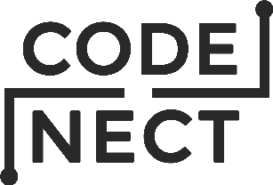

Buy the binary for Windows over at [itchio](https://flamendless.itch.io/codenect)
to support the developer

## About
CodeNect is a visual programming software developed for my thesis as a supplementary
tool for beginners in programming.

## Demo/Screenshots
Check the [media](https://github.com/flamendless/CodeNect-VPS/tree/main/media) for a ton of images

## Features
* The visual code can be compiled to *C* code using `TinyC Compiler`
* No installation needed

The following data types (slots) are supported:
* Bool
* Integer
* Float
* Double
* String

The following nodes are supported:
* Variable
* Operation - `+`, `-`, `*`, `/`
* Comparision - `==`, `!=`, `<`, `>`, `<=`, `>=`, `&&`, `||`
* Action:
	* Print
	* Prompt
	* Set
* Mathematical functions:
	* Root
	* Power
	* Sine
	* Cosine
	* Tangent
* String functions:
	* To lowercase
	* To uppercase
	* To arrray
* Get
	* Variable (string) length
	* Array size
	* Array element (by index)
* Branch/If
* For-Loop
* Data Structure:
	* Array

## Platforms
The supported platforms are:
* Linux
* Windows 7, 10 (64 bit)
* macOS (Apple Silicon / arm64, also builds on Intel)

## Requirements
* CMake (3.16 or higher on macOS for Objective-C support)
* Ninja
* Clang++ (11.1.0 or higher)
* C++17

Platform specific libraries:
* Linux: `gtk+-3.0`, `glfw3`, OpenGL
* Windows: bundled in `lib/`
* macOS: `glfw`, OpenGL (system framework), Cocoa/AppKit (system framework)

## Compiling/Building
(clone the repo first then get the submodules)

```
git clone https://github.com/flamendless/CodeNect-VPS.git
cd CodeNect-VPS
git submodule update --init --recursive
```

* For Linux, just run `./build.sh rebuild && ./build.sh compile && ./build.sh run`
* For Windows, just run `build_win.bat`
* For macOS, run `./build.sh deps_macos` once, then `./build.sh rebuild && ./build.sh compile && ./build.sh run`

### macOS release (.dmg)

After a release build (`./build.sh rebuild && ./build.sh compile`):

* **DMG:** `./build.sh dmg` → `dist/CodeNect-<version>-macOS-<arch>.dmg` (drag `CodeNect.app` to Applications)
* **Zip:** `./build.sh package_macos_app` → `dist/CodeNect-<version>-macOS-<arch>.zip`

Version comes from `version` in `config.ini`. Unsigned builds are normal for indie distribution; users may need **Right-click → Open** the first time. To sign, set `CODENECT_CODESIGN_IDENTITY` to your Developer ID Application name before running `./build.sh dmg`.

## Testing
* `cd test && ./build.sh rebuild`
* `./build.sh test_detailed` or `./build.sh test_summary`

## Tools/Libraries
CodeNect is grateful to the following tool/libraries for making it possible:
* [better-enums](https://github.com/aantron/better-enums)
* [ImGuiColorTextEdit](https://github.com/BalazsJako/ImGuiColorTextEdit)
* [fmt](https://github.com/fmtlib/fmt)
* [IconFontCppHeaders](https://github.com/juliettef/IconFontCppHeaders)
* [DearImGui](https://github.com/ocornut/imgui)
* [Doctest](https://github.com/onqtam/doctest)
* [GLFW](https://www.glfw.org/)
* [ImGuiMarkdown](https://github.com/juliettef/imgui_markdown)
* [ImNodes](https://github.com/rokups/ImNodes)
* [nativefiledialog](https://github.com/mlabbe/nativefiledialog/)
* [plog](https://github.com/SergiusTheBest/plog)
* [PPK_ASSERT](https://github.com/gpakosz/PPK_ASSERT)
* [simpleini](https://github.com/brofield/simpleini/)
* [stb_image](https://github.com/nothings/stb/blob/master/stb_image.h)
* [TinyC Compiler](https://bellard.org/tcc)
* [Tweeny](https://github.com/mobius3/tweeny)
* [CppVerbalExpressions](https://github.com/VerbalExpressions/CppVerbalExpressions/)

## AI/LLM Use Disclaimer

 AI and large language model (LLM) tools were used to help port CodeNect to macOS (including build tooling, platform-specific code, and related documentation). Output from those tools was not merged blindly: the maintainer reviewed, edited, and tested the changes to the extent of their knowledge and experience. That review does not guarantee correctness; if you spot problems in the macOS port or surrounding changes, please open an issue.

## LICENSE
License is [GNU General Public License v3.0](https://github.com/flamendless/CodeNect-VPS/blob/main/LICENSE)
